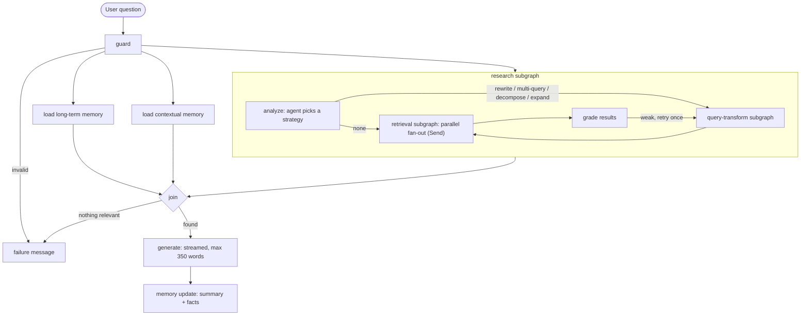

# Wiki Chat: an agentic RAG chatbot over Wikipedia

Ask a question and the app searches Wikipedia, shows relevant images first, then streams an answer with
citations. **Accurate mode** adds an LLM agent that decides whether to rewrite, expand, or decompose the
question, retries weak searches, and shows exactly what it did.

**Live demo:** <your-demo-url> · **Stack:** Python, FastAPI, LangGraph, LangChain, React, TypeScript

<!-- add 2-3 screenshots or a short GIF here -->

## Features
- **Streaming chat** with step-by-step status ("Searching Wikipedia…", "Reranking…") that collapses into a
  *Show steps* button once the answer starts. Up to 5 relevant images appear before the text.
- **Two modes.** *Normal*: fixed pipeline. *Accurate* (login only): agentic analysis, query transformation
  (rewrite / multi-query / decomposition / expansion), a quality check with one corrective retry, and a
  details panel (strategy, queries, scores, cache hits, tokens, latency per step).
- **Memory.** Short-term (recent turns), rolling summary (oldest 10 messages are summarised once history
  passes 20), contextual (embedding search over earlier turns of the same chat), and long-term facts about
  the user that they can view and delete in Settings.
- **Accounts.** Guests get 10 messages a day in Normal mode and nothing is saved. A capped number of users
  can register; each can keep 10 chats. Admin dashboard with usage, latency (p50/p95), error rates, cache
  hit rate, and user management. The admin sees counts, never chat content.
- **Reliability.** Retries with backoff, provider fallback (Groq, then Gemini), circuit breaker, per-step
  timeouts, graceful degradation (images fail but text still shows), friendly failure messages.
- **Cost control.** Token buckets per user and IP, per-user and global daily token budgets, a hard 350-word
  answer cap set by the developer.

## Architecture



**Retrieval pipeline:** Wikipedia search → parallel page fetch (disk-cached, 7-day TTL) → section-aware
chunking with metadata (page, section, revision) → dense search (cosine, BGE-small, local) + BM25 →
Reciprocal Rank Fusion → MMR for diversity → cross-encoder rerank (FlashRank) → top 5. Images are
filtered, allow-listed to `upload.wikimedia.org`, and ranked by similarity to the query.

## Security
| Risk | Measure |
|---|---|
| IDOR | `user_id` always comes from the verified cookie; every query filters by owner; foreign IDs return 404; checkpoint thread ids are namespaced per user |
| Admin access | Admin is created from environment variables, signup with that email is blocked, the role is read from the database on every request (never from the token), and every `/admin` route checks it server-side |
| Passwords | argon2id hashing; IPs and emails in lockout tables are stored as keyed HMAC hashes |
| Brute force | Per-email and per-IP lockouts of 3, 12, then 24 hours; the same generic error for unknown email and wrong password |
| Prompt injection | Fixed rules come first; the user persona is delimited, length-capped and stripped of prompt tags; Wikipedia text is wrapped and labelled as data |
| SSRF | The backend only calls fixed Wikipedia hosts; user-supplied URLs are never fetched; images are allow-listed |
| Cost abuse | Token buckets, daily token budgets, input caps, fixed `max_tokens` |
| Web | Strict CORS, httpOnly + SameSite cookies, CSP and security headers, sanitized Markdown rendering |

## Run locally
```bash
# backend
cd backend
python -m venv .venv && .venv\Scripts\activate        # macOS/Linux: source .venv/bin/activate
pip install -r requirements.txt
cp .env.example .env                                   # fill it in
python scripts/hash_password.py                        # paste the output into ADMIN_PASSWORD_HASH
uvicorn app.main:app --reload --port 8000

# frontend (second terminal)
cd frontend && npm install && npm run dev              # http://localhost:5173
```
You need free API keys from Groq and Google AI Studio. Everything else (embeddings, reranker, vector
store, database) runs locally at no cost.

## Tests
```bash
cd backend && pip install -r requirements-dev.txt && pytest -q
```
About 55 tests cover auth, lockouts, cookies, CORS, IDOR (cross-user access), admin guards (forged tokens,
role claims), retrieval components (chunking, RRF, MMR, BM25, image filtering), the agent's decisions,
and the full graph with a fake LLM and retriever. CI runs ruff, pytest and the frontend build.

## Docker and deployment
```bash
docker compose up --build        # http://localhost:7860
```
One container serves the API and the built React app. Production environment variables:
`APP_ENV=prod`, `COOKIE_SECURE=true`, `TRUST_PROXY=true`, `FRONTEND_ORIGIN=<public url>`, `JWT_SECRET`,
`HMAC_SECRET`, `ADMIN_EMAIL`, `ADMIN_PASSWORD_HASH`, `GROQ_API_KEY`, `GOOGLE_API_KEY`.

**Hugging Face Spaces:** create a Docker Space, add the variables above under *Settings → Variables and
secrets*, put the YAML header from the deployment notes at the top of the Space's README, and push the repo.
Open the app through its direct `*.hf.space` URL (cookies don't work inside the huggingface.co iframe).

## Design decisions and limitations
- **SQLite + Chroma files** instead of a database server: free, zero setup, enough for a small user base.
  Free hosts wipe the disk on restart, so accounts and chats can reset; the admin account comes from env vars.
- **Single worker:** rate limits, guest sessions and the circuit breaker live in memory.
- **Sessions are stateless JWTs:** logging out clears the cookie but doesn't revoke a copied token before it
  expires (7 days by default).
- **Behind a proxy**, the client IP is taken from `X-Forwarded-For`; a determined client could spoof it to
  dodge the guest limit (email lockouts still apply).
- **Free LLM tiers change.** Model names are configuration, and providers are tried in order with fallback.
- The "found something relevant" check uses rerank-score thresholds that were tuned by hand.